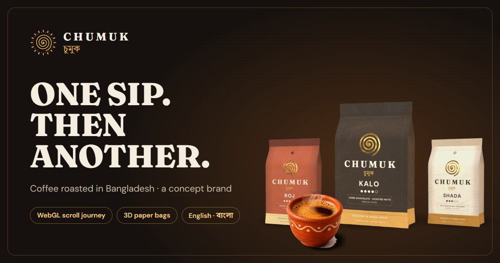

# Chumuk · চুমুক

**One sip. Then another.** A concept coffee brand from Bangladesh, built as a portfolio piece.

**Live:** https://chumuk.netlify.app



> Chumuk is not a real company. The products, prices and checkout are a demo; nothing is sold, charged or sent.

## What it does

- **A scroll journey into the cup.** Six still images become one continuous WebGL camera move: the pour, the crema,
  a vortex, under the surface, falling beans. Custom shaders animate the liquid (flow maps, swirl, steam, caustics),
  hand one image to the next and add motion blur from scroll speed.
- **A 3D bag stage.** Nine procedurally modelled paper pouches (folded gussets, crimped seal, paper fibres and creases
  generated in code, gold foil) slowly turn on a carousel that moves one bag per step.
- **A full storefront, in English and Bangla:** range with filters and search, brew guide, subscription, cart and an
  order form that builds the WhatsApp message it would send (bKash, Nagad or cash on delivery). Prices are realistic
  Bangladesh-market BDT and shown in Bangla digits in Bangla.
- **Lite mode** for browsers without WebGL or a GPU, reduced motion, data saver or 2G: a still hero and a static
  carousel, and three.js is never downloaded.
- **Built to stay smooth:** 60 fps with no dropped frames on a GTX 1650, three.js loaded only when needed, shaders compiled in parallel
  behind the loader, images lazy-loaded behind tiny placeholders. Lighthouse accessibility, best practices and SEO: 100.

## Tech

Vite · TypeScript (no framework) · three.js with custom GLSL · GSAP ticker · Lenis smooth scroll ·
self-hosted Fraunces, DM Sans, Tiro Bangla and Hind Siliguri.

## Run it

```bash
npm install
npm run dev      # http://localhost:5173
npm run build    # type-check + production build into dist/
```

Handy URL parameters: `?lite` (lite mode), `?full` (force the WebGL experience), `?skip` (skip the intro).

## Project layout

| Path | What |
|---|---|
| `src/main.ts` | Page shell: language, smooth scroll, storefront, picks full or lite mode |
| `src/experience.ts` | The WebGL experience (lazy-loaded): loader, ring burst, journey, bag stage |
| `src/gl/` | Shaders and scenes: plates (journey images), beans, ribbons, ring, bags, stage |
| `src/components/` | Storefront, stage UI, lite stage, mobile menu |
| `tools/` | Asset pipeline and test scripts (bag renders, illustrations, screenshots, frame-time and raster traces) |
| `assets-src/` | Source images the site's images are generated from |

## Credits

Design and build by Rashedul Islam Nissan, with Claude (Anthropic) as a coding partner. Scene images are AI-generated
stills; bag renders and the "How it's made" illustrations are made in code.
